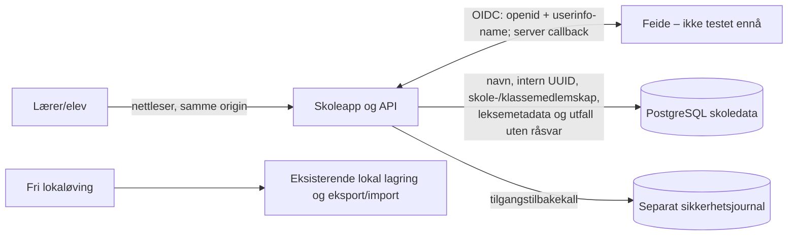

# Feide- og kommuneunderlag

Status avstemt 9. november 2026 mot [pilotstatus](pilotskole/pilotstatus.md): Feide-tjenesten er registrert, og ekstern Feide-/lekseflyt med testkontoer er dokumentert gjennomført i oktober. Signert skoleavtale, skoleeiers godkjenning og produksjonsdrift er ikke dokumentert ferdig. Målgruppen er hele ungdomsskolen og spansk nivå I i videregående; A0–A1-merking er ikke bevis på full læreplandekning.

## Gjeldende leveransestatus

Se [pilotstatus og første skolekandidat](pilotskole/pilotstatus.md) for avgrensning og restpunkter. [Demo- og tilbudsunderlaget](../salg/forste-skolepakke.md) er lokalt klargjort. Operative oppgaver følges i Beads rbec.4; salgsforberedelser kan fortsette uten elevdata mens ekstern drift avklares.

Eldre påstander nedenfor om manglende Feide-test, Sikt-kvittering og scheduler gjelder den opprinnelige lokale leveransen. De overstyres av de daterte oktoberbevisene: ekstern Feide/sterk innlogging/logout er prøvd med testkontoer, og avgrensede cron-/alarmprøver er gjennomført. Dette beviser ikke varig drift, oppdatert produksjonsoppsett eller skoleaktivering. Leverandørvalget Supabase/Vercel er tidligere vedtatt; prosjektspesifikke avtale-/driftsforhold gjenstår. Supabase svarte 21. oktober om den reserverte rolletilgangen; den konkrete begrensningen er kjent, mens øvrige spørsmål må følges hver for seg.

## Historisk omfang for den opprinnelige lokale leveransen

- **Lokalt implementert/testet:** OIDC Authorization Code + PKCE mot syntetisk lokal identitetstilbyder, eksplisitt ID-token-signaturverifikasjon, negative issuer-/audience-/nonce-/signatur-/utløpstester og JWKS-nøkkelrotasjon; serverøkter; skoleeier→skole-relasjon med fail-closed migrering av eldre skoler; separat eier-CLI for dokumentert aktivering/sperring; skoleeiers sperrer journalføres før lokale endringer, og restore gjentar sperringen mot eldre snapshot; skoleadministrator kan gi en tidsbegrenset lærerinvitasjon og se aktive skolemedlemmer; elev-/medlærerinvitasjon oppretter en ventende klasseforespørsel som aktiv klasselærer må godkjenne; lærer kan avslå forespørsel eller fjerne elev/medlærer; skoleadministrator kan fjerne skoletilgang, klassemedlemskap og aktive økter for et medlem uten å påvirke medlemskap ved andre skoler; særskilt førstegangsoppretting av skoleadministrator finnes som CLI, men er bare testet syntetisk og er ikke kjørt mot ekte skole; digitale lekser i fire områder fryser de valgte spørsmålene i et innholdssnapshot med SHA-256-versjon ved publisering; elevvisning og retting bruker samme snapshot, og gamle snapshots som mangler eller ikke består integritetskontroll brukes ikke. Læringsutfall er minimerte og tilgangskontrollerte. Et leksebesvar som får usikker nettverksfeil eller utløpt økt beholdes bare i JavaScript-minnet med samme engangshendelse-ID. Ved nettfeil må eleven prøve samme svar på nytt eller uttrykkelig forkaste det. Ved øktutløp åpnes Feide i et nytt vindu, og svaret sendes først etter at en fersk serverøkt bekrefter samme interne bruker. Syntetiske Chromium-tester dekker tapt kvittering, samme bruker, avbrutt forkasting og at svar ikke sendes til en annen konto; skolemodus skriver ikke køen til `localStorage`.
- **Feide-portal:** Tjenesten Spansk123 (ID `2198569`) er registrert hos Sikt; leverandørerklæringen ble publisert 2. oktober 2026. Dette er ikke i seg selv bevis på at Feide-klient, claims eller login/logout er aktivert og verifisert.
- **Ikke verifisert mot Feide:** ekte discovery/attributter, registrert klient/redirect-konfigurasjon, logout-endepunkt, MFA/ACR og skoleeieraktivering. Lokal simulator er ikke Feide.
- **Uavklart før produksjon:** leverandør-/EØS-strategi, datalokasjon, underleverandører, DPA, behandlingsgrunnlag, DPIA-behov, vedtatt retensjon, driftsleverandørens backup/restore og isolerte katastrofeøvelse, MFA-policy, skoleadministratorrutine, ansvarlige kontaktpersoner og pilotgodkjenning. Se [avklaringsregisteret](avklaringsregister.md) for ansvar, løsningsforslag, beviskrav og stoppunkter.
- **Implementert og lokalt testet:** egen kontosletting med sletting av identitetsbindinger og læringsresultater, tilbakekallingsjournal og replay på eldre snapshot; retensjonsjobb som journalfører utløpte lekser før sletting. Ingen av testene brukte ekte kontoer eller elevdata.
- **Ikke implementert/bevist i denne leveransen:** faktisk skoleeierverifisering/bootstrap i Sikt eller mot en skole, eieradministrasjon i nettgrensesnitt, full tenant- og rolle/statusmatrise (syntetiske tester dekker flere, men ikke alle kombinasjoner), produksjons-/leverandørbackup med isolert katastrofeøvelse, inaktivitetens varseltiming i nettleser, fysisk delt-enhetpilot, faktisk Feide-logout og distribuert service-worker-cache-verifikasjon, nettverks-/loggutgangskontroll og ASVS Level 2-verifikasjon/sertifisering. Alle 183 unike ASVS 5.0.0 L2-krav-ID-er er individuelt kartlagt i egenvurderingen; flere er delvis oppfylt, ikke implementert eller eksternt uavklart. Lokal Chromium mot PostgreSQL verifiserer samme-nettleser-kontobytte, sesjonssjekk, browser-back og at forrige elevlekse ikke gjenoppstår; dette er syntetiske kontoer og ikke kommunal enhetsverifikasjon. Ingen scheduler er satt opp; hosting og driftsansvar er uavklart. Feides virkelige ACR-claims er ikke testet.
- **Sikkerhetskontroll:** [avgrenset OWASP ASVS 5.0.0 egenvurdering](asvs-5.0.0-egenvurdering.md). Dette er ikke sertifisering eller full nivå 2-verifikasjon.
- **Logging og overvåking:** [lokalt logginventar og produksjonsporter](logging-og-overvaking.md); ingen SIEM, sentral alarm eller hostinglogg er verifisert.
- **Operative rutiner:** [hendelseshåndtering, tilgang/MFA, leverandørendringer og retensjonsjobb](operativ-kontrollrutiner.md) er utarbeidet som innføringsklart utkast. Ansvarlige, stedfortredere, godkjenning, øvelse og driftsbevis mangler; dokumentet er ikke en etablert sikkerhetsfunksjon.
- **Lukking av åpne spørsmål:** [eksterne forespørsler og svarstatus for Vercel, Supabase og Sikt](eksterne-avklaringsforesporsler.md) samt [beslutningsfelter for Oversikt AS/skoleeier](lukkeplan-og-eierbeslutninger.md). Vercel-forespørselen og Supabase-oppfølgingen er sendt; Supabase har bare bekreftet standard-DPA og Sikt har bare sendt automatisk kvittering. Dashboard-supportsak for staging-503 er sendt, men ticketnummer/svar mangler. Beslutningene fra Oversikt/skoleeier er ikke vedtatt.
- **Valideringsregler og grenser:** [gjeldende forretningsregler, inputgrenser og lokal forespørselsbegrensning](forretningsregler-og-grenser.md). Per-prosess rate limits må suppleres i valgt produksjonsgateway.

## Dataflyt

Elever og lærere får egne innloggede visninger. Faglærer oppretter klasse, deler engangsinvitasjon og tildeler hele klassen lekser. Eleven kan bare se sine tildelinger. Læreren kan se framgang for egne aktive klasser.

## Evidens

- Kode: `server/`, migreringer: `server/migrations/` og `server/journal-migrations/`.
- Lokal syntetisk oppstart begynner med `npm run build:app`, `npm run setup:school-demo`, `npm run school:db:up`, `npm run school:migrate`, `npm run school:seed`, deretter `npm run school:oidc` og `npm run school:start` i separate terminaler. Compose bruker det dedikerte prosjektet `spansk123-school-local`, med egne volumer; `npm run school:db:stop` stopper containerne uten å slette volumene. `build:app` bygger også skolekatalogen og innholdsadresserte, statiske lydkopier for publiserte lytteoppgaver. Med begge prosessene og lokal database oppe kan `npm run test:school:postgres` kjøre en syntetisk HTTP-flyt på faktisk PostgreSQL, kontrollere runtime-roller/RLS og utføre `pg_dump`/`pg_restore` med nyere journal-replay. `npm run test:school:postgres:ui` kjører i tillegg lærerens og elevens arbeidsflyt i headless Chromium mot samme lokale stack. Nettlesertesten får syntetiske kontoøkter via den lokale OIDC-callbacken; ekte Feide-innlogging i nettleseren er ikke verifisert. Testene bruker bare lokal demodata og loopback-tjenester; de verifiserer ikke ekstern drift.
- Lokale syntetiske integrasjonstester: `tests/server/` (`npm run test:school`).
- Samlet lokal status og mangler: [verifikasjon](verifikasjon.md).
- Leverandørerklæringen for Sikt-tjeneste 2198569 er publisert og oppdatert 2. oktober 2026. Dokumentene her skiller mellom publiserte fakta, lokale bevis, utkast til interne rutiner og uavklarte forhold. Ikke behandle et rutineutkast som vedtatt policy eller lokalt testresultat som produksjonsbevis.
