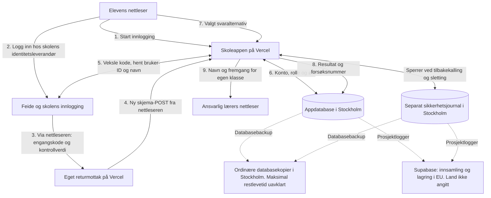

# Hvor blir elevens opplysninger av?

Teknisk vedlegg til Spansk123s databehandleravtale for skolemodus. Arbeidsutkast 20. november 2026. Oversikt skal ferdigstille egne leverandøravklaringer før første e-post til skolene. Figuren viser den beskyttede produksjonsløsningen for innlogging og den prøvde skoleflyten for en eventuell pilot. Inn- og utlogging er prøvd med en syntetisk konto på produksjonsdomenet. Klasse, lekser og læreroversikt er prøvd i staging med syntetiske brukere. Ingen skole er aktivert ved denne prøven.

## Fra Feide til lærerens oversikt

**Slik leses figuren.** Skoleappen retter svaret. Feide mottar ingen lekser eller resultater fra appen. Læreren ser hva eleven har gjennomført, og antallet riktige svar ved siste forsøk per spørsmål. Pilene til kopier viser at personopplysninger kan bestå etter sletting i aktiv database. Driftens tekniske logger, support og elevens egne nedlastinger beskrives nedenfor.

## Hva skjer når eleven logger inn?

1. Eleven åpner skoleappen på `skole.spansk123.no`. Nettstedet mottar en vanlig HTTPS-forespørsel med blant annet forbindelsesopplysninger. Ved innloggingsstart setter appen en kortvarig informasjonskapsel på skoledomenet. Databasen får en hash av den tilfeldige transaksjonsnøkkelen, kontrollverdiene `state` og `nonce`, kryptert PKCE-verifikator, type og tidsfelter. Formålet er å koble én gyldig retur til samme innlogging. Transaksjonen kan brukes én gang i fem minutter.
2. Nettleseren går til Feide. Eleven legitimerer seg hos skolens innlogging. Spansk123 ber om `openid userinfo-name` og får aldri elevens passord. Skole, rolle, klasse og klasseliste tildeles i Spansk123. Denne flyten henter ingen klasseliste fra Feide.
3. Feide sender et skjema gjennom nettleseren til `feide-retur.spansk123.no/api/feide-return`. Vercel-funksjonen ser engangskoden og `state`, eventuelt utsteder `iss`. Ved avslag kan skjemaet inneholde `error`, `error_description` og `error_uri` i stedet for kode. Funksjonen kontrollerer opprinnelse og felt, og gir nettleseren et nytt skjema med fast mål på skoleappen. Koden legger ingen opplysninger i en database og ber nettleseren om ikke å cache svaret. Skoleappens vertsbundne informasjonskapsler sendes bare til skoleappen. Plattformens behandling av forespørsler på begge vertsnavn skal dokumenteres særskilt.
4. Skoleappen veksler koden hos Feide og kontrollerer identitetsbeviset. Tilgangstokenet brukes på serveren til å hente visningsnavn og kontrollere at bruker-ID samsvarer. Appen knytter identitetsutsteder og bruker-ID (`iss`, `sub`) til intern bruker-ID og oppdaterer visningsnavnet. Databasen får øktdata, inkludert kryptert ID-token til Feide-utlogging. Tilgangstokenet skrives ikke til appdatabasen.
5. Første gyldige innlogging kan opprette navn, identitetskobling og ventende konto **før eleven får skoletilgang**. Skoleadministrator utsteder skoleinvitasjon for riktig rolle. Lærer utsteder klasseinvitasjon og godkjenner forespørselen. Kode lagres som hash med utsteder, tilhørighet og utløp. Flere aktive skolemedlemskap krever skolevalg. Lærer- og administratortilgang har tilleggskrav til Feides innloggingsnivå.
6. Lokal utlogging tilbakekaller appøkten og fjerner appens øktkapsler. En egen lenke avslutter også Feide-økten. Den går til Feides utloggingsendepunkt med ID-token som hint, returadresse og kontrollverdi. Oversikt må kontrollere hvilke opplysninger plattformen logger både ved innlogging og på denne utloggingsveien. Utløpt eller ugyldig transaksjon gir ingen ny godkjent økt.

## Hva lagres mens eleven arbeider?

| Hvor og hvorfor | Opplysninger | Hvem kan bruke dem og hvor lenge? |
| --- | --- | --- |
| Elevens nettleser, pågående skoleøkt | Tilfeldig øktkapsel utilgjengelig for JavaScript, separat CSRF-kapsel til å sikre endringer, viste oppgaver, navn, svar og tilbakemelding i sidens minne. | Eleven bruker den aktive økten. Personlige API-svar skal ikke caches. Ubekreftet valg kan sendes på nytt fra sidens minne etter nettfeil. Skoleappen oppretter ingen varig lokal svarliste. |
| Appdatabase, identitet og tilgang | Intern bruker-ID, Feide-utsteder og subjekt-ID, navn, kontostatus, skoleeier-/skole-/klassereferanser, skoleår, rolle, medlemsstatus, tilgangs-ID-er, utsteder og gyldighet for invitasjoner. | Eleven ser egen tilhørighet, læreren ser egne klasser og søknader, og skolens administrator håndterer egne skolemedlemmer. Skoledata følger avtaleperioden. Delte identiteter, ventende kontoer og restreferanser trenger egne regler. |
| Appdatabase, økt | Hash av økt- og CSRF-nøkkel, bruker-, skole- og rollekobling, innloggingsnivå når tilgjengelig, kryptert ID-token, opprettelse, siste aktivitet, utløp og tilbakekall. | Serverens avgrensede rolle kontrollerer tilgangen. Økt gyldig maksimalt 8 timer, ansatte også med inaktivitetsgrense. Invitasjon gyldig maksimalt 7 dager. Fysisk opprydding skjer separat fra utløp. |
| Appdatabase, lekse og mottakere | Tittel, klasse, område, innholds-ID/-versjon, valgte spørsmål og svaralternativer med fasit, lydreferanse, frist og hvilke elever som mottok leksen ved tildeling. | Ansvarlig lærer kan tildele og følge opp. Eleven ser egen tildeling og spørsmålene. Forhåndsinnspilt lyd er læremiddel, ikke elevens stemme. Avtaleperioden og avtalt eksportvindu. |
| Serverminne, retting | Nettleseren sender lekse-ID i stien og hendelses-ID, øvingsøkt-ID, spørsmåls-ID og enten valgt alternativ (`answerId`) eller kort tekstsvar (`textAnswer`, maks 160 tegn i skrive-/bøyingsmodus) i forespørselen. Serveren sammenligner i minnet med fasit for den tildelte versjonen. | Rettet der og da i minnet og forkastes umiddelbart. Ugyldig svar eller manglende tilgang avvises. Verken råvalget eller råteksten lagres i læringshendelsen eller i logger. |
| Appdatabase, læringshendelse | Hendelses-ID, skole-, elev- og lekse-ID, område, innholds-ID/-versjon, spørsmål, utfall, forsøksnummer, øvingsøkt-ID og tidspunkt. Hintfeltet skrives som 0. | Eleven kan se egne svarutfall. Læreren ser elevnavn, lekse, område, besvarte spørsmål, siste riktige og totalt antall. Innsending med samme hendelses-ID og samsvarende resultat gir kvittering uten dobbel registrering. Avtaleperioden og avtalt eksportvindu. |
| Appdatabase, revisjon | Skole-/aktør-ID, hendelsestype, måltype/-ID og tidspunkt ved blant annet medlemsendring, tildeling og eksport. | Avgrenset tilgang til kontroll og hendelseshåndtering. Forslag om sletting senest etter 30 dager fra hendelsen, med konkret instruert unntak ved pågående hendelse. |
| Separat journaldatabase, beskyttelse ved gjenoppretting | Referanser til tilbakekalte tilganger, brukte invitasjoner, slettede kontoer/lekser eller stengt skole, hendelseskategori, rekkefølge og tidspunkt. | Avgrensede driftsroller. Referanser kan knyttes til personer og skal behandles deretter. De må bestå så lenge eldre kopier kan gjenåpne data. Endelig maksimalfrist og utløpsbevis mangler. |
| Skolekontrollert utstyr, aktiv eksport | Eleven kan laste ned egne data som JSON. Lærer kan laste ned oversikt for egen klasse. Ved skoleopphør kan autorisert operatør levere skoleeksport til bekreftet mottaker på avtalt sikker kanal. | En nedlastet fil kan bli liggende etter utlogging og sletting hos Oversikt. Skoleeier fastsetter tilgang, plassering og sletting av kopiene den mottar. |

Skoleflyten støtter flervalg og kort produktiv skriving av enkeltord/verbformer (vurdert utelukkende i serverminnet). Den lagrer aldri fødselsnummer, elevens e-post, fritekstbesvarelser, mikrofonopptak eller egen elevanalyse. I den separate åpne øvingsappen kan eleven øve uten konto og ha fremgang, egne ord og eksportfiler på enheten. Disse flyttes ikke inn i læreroversikten ved Feide-innlogging. Eventuell besøksmåling på offentlig forside er avgrenset fra skole-, innloggings- og API-ruter.

## Hvor kan opplysningene behandles?

| Tjeneste | Dokumentert plassering eller behandling | Hva gjenstår og hvem avklarer det? |
| --- | --- | --- |
| Feide/Sikt og skolens identitetsleverandør | Kontrollerer innlogging og leverer de avtalte attributtene. Føderasjons-/vertsorganisasjonsavtalen må identifiseres særskilt. | Skoleeier bekrefter part, behandlingsrolle, hvilke identitetslogger som føres, behandlingsland, lesetilgang og frister for egen innloggingskjede. |
| Vercel, skoleapp og returmottak | Stockholm (`arn1`) er valgt funksjonsregion, og returmottaket er observert der. Nettverk, trafikkvern og HTTPS-terminering kan behandle IP-adresse, tidspunkt, brukeragent og forespørselsmetadata. Appen bruker IP-baserte tellere i minnet med ett minutts tellevindu. Utløpte nøkler kan ligge i minnet lenger. | Oversikt må avklare land for mottak ved nettverkskanten, intern logging, midlertidige kopier og fjerntilgang samt hvilke mottakere som behandler hvilke felt. |
| Vercel, logger og overføring | Teamet har Pro uten Observability Plus. Den 20. november viste teamets oppsett ingen konfigurerte loggstrømmer til eksterne mål (Drains). Pro viser funksjonslogger i ett døgn. Vercel Inc. stod som aktiv deltaker for andre data enn personaldata («non-HR») i EU–US Data Privacy Framework ved kontroll 20. november. | Dokumenter faktisk maskering og maksimal oppbevaring for sikkerhetslogger, interne logger, feilsøking og restkopier. Skill Vercels opplysninger til egne formål fra kundedata på instruks. Hver videreoverføring krever vurdering av mottaker, omfang og grunnlag. |
| Supabase, app og sikkerhetsjournal | To produksjonsprosjekter i Stockholm (`eu-north-1`), hvert med egen avgrenset databaseinnlogging over TLS. Supabase Pte. Ltd. i Singapore er avtalepart under standardvilkårene. Supabase, Inc. i USA kan bistå med drift og support. Supabase viser til standard personvernbestemmelser (SCC) for Singapore og USA. | Dokumenter den konkrete mottakerkjeden, relevant SCC-modul og vurdering av overføringene. Oppgi enhetene som kan få tilgang til skoledata og fra hvilke land. |
| Supabase, automatiske kopier | Supabase oppgir at ordinære databasekopier blir i valgt region, altså Stockholm for begge prosjektene. Pro oppgir sju dagers lagring. Kontroll i produksjon 20. november viste åtte fullførte fysiske kopier per prosjekt, datert 13.–20. november. Begge hadde kontinuerlig gjenoppretting til valgfritt klokkeslett (PITR) avslått. | Dokumenter seneste tidspunkt en slettet rad kan gjenopprettes fra noen kopi, inkludert transaksjonsarkiv og eventuelle operatørkopier. Supabase angir opptil 30 dager for kundedata når et helt prosjekt slettes. Ved opphør for én skole lever fellesprosjektene videre. Fastsett journalens frist etter faktisk kopihorisont. |
| Supabase, logger | Supabase oppgir innsamling og lagring av driftslogger i EU-datasentre og sju dagers loggretensjon på Pro. Kontroll av databaseinnstillinger 20. november viste samme verdier i begge prosjektene. PostgreSQL logger strukturendringer og kan logge SQL-tekst ved feil. Tilleggslogging av bundne parameterverdier ved feil var av i kontrolløktene. | Identifiser EU-land, relevante felt, eventuelle videresendinger og mottakere for prosjekt-, plattform- og supportlogger. Fastsett de lengste fristene og hva som kan fremgå av feiltekst og leverandørinterne poster. |
| Supabase, fjerntilgang ved support | Det globale supportteamet kan ved henvendelse eller oppdaget sikkerhetshendelse se relevante logger, konfigurasjon og om nødvendig et utvalg av kundedata. Supabase oppgir at tilgangen begrenses til behovet og loggføres. | Avklar hvilke land Oversikts prosjekter kan nås fra, hvem som får innsyn, hvor supportkopier lagres, når de slettes og hvordan tilgangen kan etterprøves. Oversikt skal bruke syntetiske eksempler i henvendelser. |
| Teknisk overvåking og DNS | Healthchecks mottar tomt driftssignal, tilfeldige kjøringsreferanser, normale forbindelsesmetadata og operatørkontakt. Signalene gjelder jobben og skal ikke inneholde elevidentitet, skole-ID eller råfeil. Domene.no håndterer domenekobling. Et DNS-oppslag kan innebære vertsnavn og forbindelsesmetadata. | Beskriv reelle mottakere og deres roller i endelig bilag. Kundens nettverk og navnetjener kan også føre egne logger. Ingen læringshendelser eller Feide-tokens skal legges i DNS eller overvåkingssignalene. |

Render inngår ikke i den dokumenterte kjeden for Spansk123. Et eventuelt krav om at all behandling, også supportinnsyn, logger og kopier, skjer i Norge eller EØS må prøves mot hvert ledd. Oversikt skal fylle ut faktiske behandlingsland, eventuelle overføringsgrunnlag og tilleggstiltak før første henvendelse til skolene. Opplysninger som bare skolen kjenner, som valg av egen kontaktperson og mottaker for eksport, fylles ut med den aktuelle skolen.

## Hva skjer ved avvik, utmelding og sletting?

- **Brutt nettforbindelse.** Uten kvittering kan svaret enten ha nådd serveren eller bare ligge i den åpne fanen. Eleven kan prøve på nytt med samme hendelses-ID. Databasen blir kilde til bekreftet fremgang ved ny lasting.
- **Eleven slutter i en klasse.** Når tilgangen blir tilbakekalt, kan eleven eller lærerens klassevisning ikke lenger bruke det tilbakekalte medlemskapet for å se elevdata. Sperring og fysisk sletting har ulike tidspunkter. Ansvarlig lærer beholder bare tilgang innenfor sine aktive klasserettigheter.
- **Elevkonto slettes.** Identitetskoblingen og elevens læringshendelser fjernes fra aktiv konto, sesjoner sperres og mottakerkoblinger slettes. Intern kontoreferanse med status «slettet» og sikkerhets-/revisjonsreferanser kan bestå. Skolevis avvikling må bevare personens aktive tilhørighet ved andre skoler.
- **Skoleavtalen avsluttes.** Oversikt stenger skolens tilgang, men beholder grunnlaget for instruert eksport. Forslaget er sikker overlevering og aktiv sluttsletting senest 30 dager etter opphør. Skoleeier bekrefter mottaker og frist. Slettebekreftelsen spesifiserer innhold, system og tidspunkt og oppgir hvilke rester som består, hvorfor, hvor lenge og hvem som følger opp.
- **En kopi må gjenopprettes.** Tilgang skal holdes stengt til nyere tilbakekallinger og slettinger er anvendt fra den separate journalen. Dette er prøvd lokalt med syntetiske data 19. november. Leverandørprøve, endelig kopihorisont og tilhørende journalfrist gjenstår. Ved manglende journalbevis skal data ikke gjenåpnes.

## Grunnlag for kontroll

Innloggingskoden, returmottaket og den frosne skolekandidaten ligger til grunn for feltbeskrivelsen. Kommunen kan be Oversikt om datert underlag for sin vurdering. Ved signering skal partene registrere hvilken versjon av dette vedlegget som omfattes, og fylle inn avklaringene i leverandørbilaget.

- [Produksjonsprøven 19. november og etterkontroll 20. november](../../thoughts/shared/plans/2026-11-19_feide-produksjon-og-restoreproeve.md) og [produksjonsdatabasene](produksjonsleveranse.md).
- [Skoleflyten i staging](../../output/external-staging-control-2026-11-12/README.md), [frosset kildegrunnlag](../../output/release-candidate-2026-11-12/candidate.json), [validering av returen](../../deploy/feide-return/api/feide-return.mjs) og [serverens Feide-utveksling](../../server/oidc-service.js).
- [Drift og slettejobb](drift-og-beredskap.md), [leverandører og frister](leverandor-og-fristbilag.md), [databehandleravtalen](databehandleravtale.md) og [informasjon til elever og ansatte](personverninformasjon.md).

- [Supabases oversikt over lagringssteder, fjerntilgang og overføring](https://supabase.com/legal/privacy-resources/data-residency-and-transfers-faq), [Pro-vilkår for logger og kopier](https://supabase.com/pricing) og [Supabases databehandleravtale](https://supabase.com/legal/customer-resources/data-processing-addendum).
- [Vercels dokumentasjon om funksjonslogger](https://vercel.com/docs/logs/runtime) og [Vercels oppføring i DPF-registeret](https://www.dataprivacyframework.gov/participant/6847).
